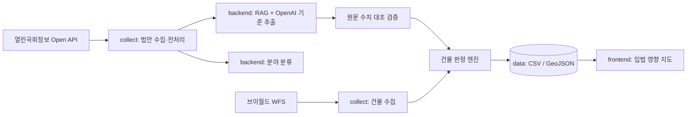

# 법안 영향 지도 (law-impact-map)

<div align="center">

### - 이 법 통과되면 우리 동네 몇 채? -
#### 국회 계류 법안의 적용 기준을 AI로 읽고, 영향받는 건물을 지도에 표시하는 입법 영향 지도
<br />


<br />
충북대학교 소프트웨어학부 「인공지능 프로그래밍」 2026-2 기말 팀 프로젝트 · C조
</div>

<br />

## ☁️ Introduction

국회 법안은 글로만 공개됩니다. "준공 30년 넘은 공동주택은 정밀안전진단을 받아야 한다" 같은 법안이 나와도, 어느 동네의 어떤 건물이 몇 채나 해당하는지는 알 수 없습니다.

이 프로젝트는 법안의 제안이유·주요내용에서 **적용 기준(용도·면적·층수·연도)** 을 AI로 추출하고, 건물 데이터와 대조해 **영향받는 건물을 건물 단위로 지도에 표시**합니다.

| 기능 | 설명 |
| :---: | --- |
| 법안 수집 | 열린국회정보 Open API로 건축·주거·안전 분야 계류 법안 수집 |
| 분야 분류 | 법안 텍스트를 분야(소방, 구조·노후, 주거 등)로 자동 분류 |
| 기준 추출 | OpenAI + RAG로 법안 조문에서 `{용도, 면적, 층수, 연도}` 규칙 추출, 원문 수치와 자동 대조 |
| 건물 판정 | 규칙 × 건물 속성 → **대상 / 경계선 / 비대상 / 판정불가** |
| 지도 시각화 | 법안 선택 시 대상 건물 채색, 건물 클릭 시 걸린 법안 목록 |

<br />

## 🧭 Project Scope

- 시범 지역: 청주시 서원구 **사창동** (2,448동) → 동 단위로 확장
- 법안 범위: 22대 국회 건축·주거·안전 관련 법안
- 판정 결과는 **건축물 데이터 기반 추정**이며 법률 판단이 아닙니다.

| 판정 | 의미 |
| :---: | --- |
| 대상 | 추출한 기준을 모두 충족 |
| 경계선 | 기준에 근소하게 못 미침 (예: 기준값 ±10%, 연도 ±1년). 입법 사각지대 후보 |
| 비대상 | 기준에 해당하지 않음 |
| 판정불가 | 판정에 필요한 속성이 비어 있음 (사창동 13.4%) |

<br />

## 📊 Data

| 데이터 | 출처 | 활용 |
| :--- | :--- | :--- |
| 법안 목록·제안이유·심사 경과 | 열린국회정보 Open API | 분야 분류, 기준 추출의 입력 |
| 건물통합정보 (`lt_c_bldginfo`) | 국토교통부 브이월드 WFS | PNU, 주용도, 연면적, 층수, 사용승인일, 구조, 건물 도형 |
| 행정동 경계 | `data/cheongju_emd.geojson` | 동 단위 수집 범위, 동별 집계 |

**사창동 건물 데이터 점검 결과** ([docs/data_check.md](docs/data_check.md))

| 항목 | 결과 |
| :--- | :--- |
| 수집 건물 | 2,448동 (동 경계 안, 중복 제거) |
| 판정 가능 (건축물대장 연계) | 2,120동, 86.6% |
| 판정 4개 기준 (용도·면적·층수·연도) | 모두 브이월드 한 곳에서 확보 |
| PNU·좌표 | 100% |
| 없는 항목 | 세대수, 세부용도, 용도지역 (필요 시 건축HUB·용도지역 레이어로 보완) |

<br />

## 💻 Architecture



```text
law-impact-map/
├─ collect/    # 수집·전처리 (Python)
│  └─ fetch_cheongju_buildings.py   # 브이월드 건물통합정보 동 단위 수집
├─ backend/    # 분야 분류, RAG 기준 추출, 판정 API
├─ frontend/   # 지도 화면
├─ data/       # 샘플 데이터 (CSV, GeoJSON)
└─ docs/       # 기획, 아키텍처, 데이터 점검, 트러블슈팅
```

<br />

## 🛠️ Tech Stack

| 수집·전처리 | AI | 데이터 | 시각화 |
| :---: | :---: | :---: | :---: |
|  | <br /> | <br /> |  |

<br />

## 🚀 Getting Started

```bash
git clone https://github.com/cbnu-lawmap/law-impact-map.git
cd law-impact-map
cp .env.example .env   # API 키 입력
```

`.env`

```text
ASSEMBLY_API_KEY=   # 열린국회정보
OPENAI_API_KEY=
VWORLD_KEY=         # 브이월드 (Referer 등록 도메인 필요)
```

건물 데이터 수집 (동 이름은 `data/cheongju_emd.geojson` 기준)

```bash
python collect/fetch_cheongju_buildings.py --emd 사창동
```

<br />

## 🔒 Policy & Ethics

| 항목 | 원칙 |
| :--- | :--- |
| 개인정보 | 건물명(`bld_nm`)에 개인 이름이 섞여 있어 저장하지 않음. 소유자 등 개인 식별 정보 미수집 |
| AI 신뢰성 | 추출 기준마다 법안 원문 근거 표시, 원문 수치와 불일치하면 채택하지 않음 |
| 정치 중립 | 의원·정당 평가나 순위 표시 없음 |
| 보안 | API 키는 `.env`에만 저장, 커밋 금지. OpenAI에는 공개 법안 텍스트만 전송 |
| 고지 | 판정 결과는 건축물 데이터 기반 추정이며 법률 자문이 아님 |

<br />

## 📅 Progress

| 단계 | 상태 |
| :--- | :---: |
| 주제·역할·협업 규칙 확정 | 완료 |
| 저장소·폴더 구조 | 완료 |
| 사창동 건물 수집·점검 | 완료 |
| 열린국회정보 법안 수집 | 진행 중 |
| 분야 분류·기준 추출 (AI) | 예정 |
| 건물 판정·지도 화면 | 예정 |
| 보고서(한글)·발표자료(PPT) | 예정 |

<br />

## 👥 Member

| [최현규](https://github.com/choihyungyu0) | 도관우 | 지서윤 |
|:---:|:---:|:---:|
| Team Leader<br />Frontend · Architecture · 건물 데이터 | Backend<br />법안 수집 · 전처리 | Backend · Docs<br />RAG · GitHub 규칙 · 기획 |

<br />

## 💡 Commit Convention

- **feat**: 새로운 기능 추가
- **fix**: 버그 수정
- **docs**: 문서 수정
- **refactor**: 기능 변화 없는 코드 구조 개선
- **data**: 데이터 추가·갱신
- **chore**: 설정, 패키지 등 기타 작업

브랜치: `main` 보호, `feature/*`에서 작업 후 PR, 1명 이상 리뷰 후 병합

<br />

## 📎 Reference

- 데이터 점검: [docs/data_check.md](docs/data_check.md)
- 데이터 출처표: [data/README.md](data/README.md)
- [열린국회정보 Open API](https://open.assembly.go.kr/portal/openapi/main.do)
- [브이월드 오픈API](https://www.vworld.kr/dev/v4api.do)
