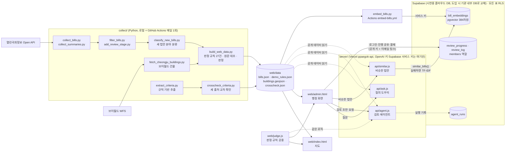

# 빼곡 (law-impact-map)

<div align="center">

### - 이 법 통과되면 우리 동네 몇 채? -
#### 국회 계류 법안의 적용 기준을 AI로 읽고, 영향받는 건물을 지도에 표시하는 입법 영향 지도
<br />


<br />

**[🗺️ 시제품 바로가기 (사창동 시범)](https://cbnu-lawmap.github.io/law-impact-map/)**

<br />
충북대학교 소프트웨어학부 「인공지능 프로그래밍」 2026-2 기말 팀 프로젝트 · C조
</div>

<br />

## ☁️ Introduction

국회 법안은 글로만 공개됩니다. "준공 30년 넘은 공동주택은 정밀안전진단을 받아야 한다" 같은 법안이 나와도, 어느 동네의 어떤 건물이 몇 채나 해당하는지는 알 수 없습니다.

이 프로젝트는 법안의 제안이유·주요내용에서 **적용 기준(용도·면적·층수·연도)** 을 AI로 추출하고, 건물 데이터와 대조해 **영향받는 건물을 건물 단위로 지도에 표시**합니다.

| 기능 | 설명 |
| :---: | --- |
| 법안 수집 | 열린국회정보 Open API로 건축·주거·안전 분야 계류 법안 수집 |
| 분야 분류 | 법안 제안이유를 9개 분야로 분류하는 신경망 (직접 학습) |
| 통과 예측 | 21대 국회 처리 결과로 학습한 신경망이 계류 법안의 반영 가능성 추정 |
| 건물 빈칸 추정 | 판정불가의 원인인 빈 연면적·사용승인일·지상층수를 모양·이웃으로 구간 추정하는 신경망 (참고용, 판정에 안 씀). 건축물대장 표제부 값을 먼저 쓰고(대장 값 우선) 그래도 빈 건물만 추정 |
| 기준 추출 | 법안 요약문에서 `{용도, 면적, 층수, 연도, 세대수}` 규칙 추출. 판정 시범 27건 중 25건은 Claude로 추출한 뒤 근거 문구가 원문에 그대로 있는지, 숫자가 근거에 있는지 자동 대조 (담당자 확인 전) |
| 교차 확인 | 같은 법안을 세 방식(우리 AI 추출, 규칙 기반 추출, 팀원 AI 추출)으로 뽑아 같은 숫자면 「교차 확인됨」, 다르면 「확인 필요」 |
| 건물 판정 | 규칙 × 건물 속성 → **대상 / 경계선 / 비대상 / 판정불가** |
| 지도 시각화 | 법안 선택 시 대상 건물 채색, 건물 클릭 시 속성과 판정 사유 |
| 행정 화면 | 담당 공무원용 상황판, 법안 검토 목록(심사 단계 포함), 진행 관리, 검토서 인쇄·한글(HWPX) |
| 질의 도우미 | 13주차 검색 증강 생성(RAG): 관련 법안을 찾아 그 내용만 근거로 답하는 AI 질의 (`server/api/ask.js`) |
| 검토 에이전트 | AI가 도구를 골라 법안 조회 → 기준 추출 → 교차 확인 → 건물 판정 → 검토서 초안까지 진행 (`server/api/agent.js`, 사람 확인 필요) |

<br />

## 🧭 Project Scope

- 시범 지역: 청주시 서원구 **사창동** (2,448동) → 동 단위로 확장
- 법안 범위: 22대 국회 건축·주거·안전 관련 법안
- 판정 결과는 **건축물 데이터 기반 추정**이며 법률 판단이 아닙니다.

| 판정 | 의미 |
| :---: | --- |
| 대상 | 추출한 기준을 모두 충족 |
| 경계선 | 기준에 근소하게 못 미침 (예: 기준값 ±10%, 연도 ±1년). 입법 사각지대 후보 |
| 비대상 | 기준에 해당하지 않음 |
| 판정불가 | 판정에 필요한 속성이 비어 있음 (사창동 13.4%) |

<br />

## 📊 Data

| 데이터 | 출처 | 활용 |
| :--- | :--- | :--- |
| 법안 목록·제안이유·심사 경과 | 열린국회정보 Open API | 분야 분류, 기준 추출의 입력 |
| 건물통합정보 (`lt_c_bldginfo`) | 국토교통부 브이월드 WFS | PNU, 주용도, 연면적, 층수, 사용승인일, 구조, 건물 도형 |
| 행정동 경계 | `data/cheongju_emd.geojson` | 동 단위 수집 범위, 동별 집계 |

**사창동 건물 데이터 점검 결과** ([docs/data_check.md](docs/data_check.md))

| 항목 | 결과 |
| :--- | :--- |
| 수집 건물 | 2,448동 (동 경계 안, 중복 제거) |
| 판정 가능 (건축물대장 연계) | 2,120동, 86.6% |
| 판정 4개 기준 (용도·면적·층수·연도) | 모두 브이월드 한 곳에서 확보 |
| PNU·좌표 | 100% |
| 없는 항목 | 세대수, 세부용도, 용도지역 (필요 시 건축HUB·용도지역 레이어로 보완) |

<br />

## 💻 Architecture



**Supabase 보안 정리** ([docs/supabase.md](docs/supabase.md))

- 모든 표에 RLS 를 켰고, 쓰기는 정책과 함수(`approve_review` 등)로만 허용합니다.
- 브라우저에는 공개(anon/publishable) 키만 배포 때 넣습니다(`SUPABASE_ANON_KEY` → `web/config.js`). 서비스 키는 Vercel 환경변수와 GitHub Actions secrets 에만 있습니다.
- 역할(담당자 / 결재자)은 `members` 표로만 정합니다. 담당자는 진행 상태·메모를 저장하고, 결재자는 읽기 전용으로 결재만 합니다.
- 키가 없거나 연결이 안 되면 예전처럼 각 브라우저(localStorage)에만 저장하고, 비슷한 법안은 단어 유사도(TF-IDF)로 찾습니다.
- 시연용 클라우드 DB 이며, 실제 도입 시에는 같은 스키마를 기관 내부 PostgreSQL + pgvector 로 옮기고 `web/cloud.js`·`server/lib/supabase.js` 만 바꿉니다.

```text
law-impact-map/
├─ collect/    # 수집·전처리·판정 데이터 생성 (Python)
├─ server/     # Vercel 서버리스: api/ask.js(질의 도우미), api/agent.js(검토 에이전트), api/similar.js(비슷한 법안)
├─ supabase/   # 시연용 클라우드 DB 스키마(schema.sql)와 마이그레이션 (docs/supabase.md)
├─ web/        # GitHub Pages 정적 사이트: index.html(지도), admin.html(행정 화면), judge.js(판정)
├─ data/       # 원천·중간 데이터 (CSV, GeoJSON)
├─ notebooks/  # 분야 분류 모델 학습
├─ docs/       # 데이터 점검, 코드표, 추출 방식 문서
└─ .github/workflows/  # pages.yml(배포), daily-collect.yml(매일 새 법안 수집), embed-bills.yml(법안 임베딩·비교)
```

예전 계획의 `backend/`(RAG API)와 `frontend/`는 실제로 만들지 않아 지웠습니다. 서버 코드는 `server/`, 화면은 `web/`에 있습니다. 질의 도우미는 13주차의 검색 증강 생성(RAG) 구조입니다: 질문과 관련된 법안을 먼저 찾고(검색, 법안명·요약문 단어 일치) 찾은 법안 내용만 근거로 답을 생성합니다. 법안 상세의 "비슷한 법안"은 요약문 임베딩(`paraphrase-multilingual-MiniLM-L12-v2`, Supabase pgvector)으로 찾고, 안 되면 단어 유사도(TF-IDF)로 대신하며 어느 방법을 썼는지 화면에 표시합니다. 두 방법 비교는 [docs/similar_compare.md](docs/similar_compare.md) (숫자는 `collect/compare_similar.py` 가 씀).

| 비슷한 법안 찾기 (같은 법률 법안 691건) | top-3 적중률 | top-1 적중률 |
| :--- | ---: | ---: |
| 단어 유사도(TF-IDF) | 88.6% | 73.2% |
| 의미 검색(pgvector 임베딩) | 70.6% | 50.7% |
| 하이브리드: 단어 + 의미 결합(RRF, k=60) | 83.8% | 67.4% |

규칙(결합 top-3 ≥ TF-IDF top-3 이면 결합)에 따라 서버 기본 방법은 단어 유사도(TF-IDF)입니다 (`web/data/similar_method.json`).

<br />

## 🧠 AI·학습 모델

**강의계획서와 맞춘 곳** (「인공지능 프로그래밍」 2026-2)

| 주차 | 수업 내용 | 이 프로젝트에서 |
| :---: | :--- | :--- |
| 1주차 | 인공지능 개념 (규칙 기반 AI와 학습하는 AI) | 규칙 기반 기준선(법률명 → 분야, 이웃 다수결), 규칙 기반 기준 추출(`collect/extract_criteria.py`) |
| 3주차 | 딥러닝 개념, 인공신경망 | 세 노트북의 Keras `Sequential` + `Dense` 신경망 |
| 4주차 | 플레이그라운드 텐서플로 (은닉층·과적합 체험) | 노트북마다 은닉층 실험, 과적합 확인(학습 vs 테스트, early stopping) |
| 9주차 | 숫자 인식 (Dense 분류, 정확도·오답 분석) | 분야 분류를 숫자 인식과 같은 구조로 (784픽셀 → TF-IDF 3,000, 10개 → 9개 분야), 혼동행렬·오답 분석 |
| 10주차 | 전염병 예측 (RNN, 시계열) | 발의량 예측: 10주차와 같은 순서(정규화 → 과거 n주 입력 → SimpleRNN + Dense(1) → RMSE → 실제·예측 그래프) |
| 12주차 | 생성형 AI와 로컬 LLM | 로컬 LLM 비교 노트북, 에이전트 모델 공급자 환경변수(`AGENT_LLM_BASE_URL`) |
| 13주차 | 검색 증강 생성(RAG) | 질의 도우미(`server/api/ask.js`): 질문과 관련된 법안을 먼저 찾고 그 내용만 근거로 답을 생성. 검토 에이전트의 1회 RAG·Agentic RAG 방식 비교 ([설계](docs/agentic_rag.md)) |

팀이 직접 학습한 모델 네 개가 중심입니다. 분야 분류·통과 예측·건물 빈칸 추정은 Keras `Sequential` + `Dense`, 발의량 예측은 10주차와 같은 `SimpleRNN` 구조이고, 노트북은 Colab에서 처음부터 끝까지 그대로 실행됩니다(데이터는 GitHub raw에서 읽음). 저장소에 올린 노트북에는 실행 결과(그래프·숫자)가 남아 있습니다.

| 강의 주차 | 노트북 | 문제 | 데이터 | 기준선 | 신경망 | 화면에 쓰이는 곳 | Colab |
| :---: | :--- | :--- | :--- | :--- | :--- | :--- | :---: |
| 1·3·4·9주차 | [분야 분류](notebooks/field_classifier.ipynb) | 법안 제안이유 → 9개 분야 | 사람이 붙인 라벨 298건 | 규칙(법률명) 0.757, 로지스틱 회귀 0.808 (10회 평균 정확도) | Dense 128 → Softmax 9, **0.788 ± 0.043** | 지도·행정 화면 분야 필터, 에이전트 `classify_field`. 검증(10회 평균)이 높은 **로지스틱 회귀**를 화면에 씀. 확신도 0.50 미만 "분류 확인 필요" (10회 검증 예측에서 이 구간 정확도 0.487, 나머지 0.886) | [](https://colab.research.google.com/github/cbnu-lawmap/law-impact-map/blob/main/notebooks/field_classifier.ipynb) |
| 1·3·4·9주차 | [통과 예측](notebooks/pass_prediction.ipynb) | 법안 내용이 법에 반영될까 (가결·대안반영) | 21대 국회 같은 범위 처리 확정 1,087건 + 공동발의·제안일 위원회 소속(제안 시점 정보) | 다수 클래스 정확도 0.642, 로지스틱 회귀 AUC 0.722 | Dense 16 → Sigmoid, **AUC 0.718**, F1 0.56 (시간 분리 AUC 0.662, 공동발의 정보 넣기 전 0.625) | 행정 화면 법안 상세·목록 "통과 가능성 높음/보통/낮음" (시간 분리 시험에서 정한 구간, 구간별 실제 반영률 5% / 10% / 22%), 에이전트 `predict_pass` | [](https://colab.research.google.com/github/cbnu-lawmap/law-impact-map/blob/main/notebooks/pass_prediction.ipynb) |
| 1·3·4·9주차 | [건물 빈칸 추정](notebooks/building_imputation.ipynb) | 판정불가 원인 속성이 빈 건물의 연면적(4구간)·사용승인 연대(4구간)·지상층수(5구간) | 사창동에서 그 속성이 있는 건물 (연면적 2,123동, 사용승인 2,129동, 층수 2,119동, 건축물대장 표제부 대장 값 우선 반영) | 로지스틱 회귀 연면적 0.694·층수 0.538, 이웃 8동 다수결 사용승인 0.610 | 대상마다 Dense 64-32 → Softmax, 연면적 **0.725**, 사용승인 연대 **0.554** (이웃 다수결 0.610 보다 낮아 화면에는 이웃 다수결을 씀), 지상층수 **0.564** | 지도 건물 카드 "추정 연면적·사용승인 연대·지상층수 (참고용 · 판정에 쓰지 않음)" | [](https://colab.research.google.com/github/cbnu-lawmap/law-impact-map/blob/main/notebooks/building_imputation.ipynb) |
| 10주차 | [발의량 예측](notebooks/bill_volume_rnn.ipynb) | 다음 주 국토교통위원회 의원 발의 법안 수 | 21·22대 의원 발의 주별 발의량 338주 | 지난주 값, 4주 이동평균 (RMSE) | 10주차 실습과 같은 SimpleRNN(3) → Dense(1), MinMaxScaler, 과거 n주 입력 (n 4·8·12 실험, LSTM 비교) | 행정 화면 상황판 "다음 주 예상 발의량 (예측·참고용)" | [](https://colab.research.google.com/github/cbnu-lawmap/law-impact-map/blob/main/notebooks/bill_volume_rnn.ipynb) |

- 노트북마다 같은 순서입니다: 문제 → 데이터 → 전처리 → 학습/테스트 분리 → 기준선 → 신경망 → 과적합 확인 → 은닉층 실험 → 오답 분석 → 결과표 → 화면에 쓰이는 곳.
- **화면에는 검증에서 더 잘 맞는 방법을 씁니다.** 분야 분류는 로지스틱 회귀, 사용승인 연대 추정은 이웃 8동 다수결, 나머지는 신경망입니다. 신경망과의 비교는 노트북에 그대로 남깁니다.
- 세 모델 모두 같은 특징의 로지스틱 회귀와 차이가 흔들림 범위 안입니다. 데이터가 적어 은닉층이 주는 이득이 작다는 것도 결과로 적었습니다. 분야 분류는 노트북이 10회 평균 정확도가 높은 쪽(지금은 로지스틱 회귀)을 골라 화면에 내보냅니다. 같은 형식(은닉층 없는 Dense 한 층 + Softmax)이라 서버 계산은 그대로입니다.
- 숫자는 시드를 고정해도 실행하는 CPU 종류에 따라 셋째 자리가 조금 달라질 수 있습니다. 노트북의 결과표는 실행한 숫자로 코드가 만듭니다.
- 학습한 가중치는 `web/data/models/`로 내보내고, 서버(`server/lib/nn.js`)가 TensorFlow 없이 같은 계산을 합니다. `node server/test/nn.js`가 노트북 예측(Keras 또는 로지스틱 회귀 `predict_proba`)과 서버 계산이 같은지 확인합니다.
- 노트북을 고쳐 main이 아닌 브랜치에 올리면 GitHub Actions(`run-notebooks.yml`)가 리눅스 + 파이썬 3.12 + TensorFlow로 다시 실행하고 결과를 커밋합니다.
- 통과 예측 학습 데이터는 `collect-history.yml`(수동 실행)이 열린국회 API에서 모은 `data/bills_history_21.csv`입니다. 의원 이름·정당은 쓰지 않습니다. 공동발의 인원과 제안일에 소관 위원회 위원이었는지(숫자·0/1)는 `collect-process.yml`이 모은 `data/bills_process_21.csv`·`_22.csv`에서 가져옵니다. 위원회 상정처럼 제안 뒤에 생기는 정보는 노트북에서 비교만 하고 화면에는 쓰지 않습니다.

### 로컬 LLM 비교 ([notebooks/local_llm_extraction.ipynb](notebooks/local_llm_extraction.ipynb)) [](https://colab.research.google.com/github/cbnu-lawmap/law-impact-map/blob/main/notebooks/local_llm_extraction.ipynb)

**왜 로컬 LLM인가**: 지자체 업무망은 인터넷과 분리(망분리)돼 외부 AI API를 못 쓰는 경우가 많고, 모델을 기관 안에 두면 법안 원문·검토 메모가 외부로 나가지 않으며, 호출마다 드는 API 비용도 없습니다.
노트북은 공개 모델 **Qwen2.5-1.5B-Instruct**(Apache-2.0)를 Hugging Face transformers로 CPU에서 돌려, 에이전트와 **같은 지시문·같은 원문 대조 규칙**으로 시범 법안 26건의 적용 기준을 뽑고 OpenAI gpt-4o-mini와 비교합니다. 파이썬으로 옮긴 원문 대조는 서버 `verify()` 결과를 담은 시험 사례(`data/verify_cases.json`, `server/scripts/verify-cases.js`)와 모두 같은지 먼저 확인합니다.

| 시범 법안 26건 (같은 지시문·같은 원문 대조) | 로컬 Qwen2.5-1.5B-Instruct (CPU 4스레드) | OpenAI gpt-4o-mini (배포된 에이전트, 2026-11-23 수집) |
| :--- | :---: | :---: |
| 원문 대조 통과 후보 / 모델이 낸 후보 | 1 / 23 (4.3%) | 20 / 47 (42.6%) |
| 기준이 하나라도 통과한 법안 | 1 | 14 |
| 시범 규칙과 일치 · 부분 일치 · 틀림 · 못 뽑음 | 0 · 0 · 1 · 25 | 7 · 5 · 2 · 12 |
| JSON 형식 실패 | 11 | 알 수 없음 (서버가 정규식으로 대신함) |
| 시간 · 비용 | 31분 (법안당 71초), 비용·외부 전송 없음 | API 사용료, 원문 외부 전송 |

1.5B 모델은 짧게 쓴 서버 지시문의 형식 설명(`"용도|연면적|…"`)을 값으로 베끼는 경우가 많아 거의 뽑지 못했습니다. 원문 대조가 이를 모두 걸러 내므로 틀린 기준이 판정에 들어가지는 않습니다. 실제로 쓰려면 예시를 붙인 지시문이나 7B 이상 모델이 필요합니다 (노트북 9절).

<br />

## 🛠️ Tech Stack

| 수집·전처리 | AI | 데이터 | 시각화 |
| :---: | :---: | :---: | :---: |
|  | <br /> | <br /> |  |

<br />

## 🚀 Getting Started

```bash
git clone https://github.com/cbnu-lawmap/law-impact-map.git
cd law-impact-map
cp .env.example .env   # 로컬 수집용 키 입력 (커밋 금지)
```

`.env`

```text
ASSEMBLY_API_KEY=   # 열린국회정보
VWORLD_KEY=         # 브이월드 (Referer 등록 도메인 필요)
```

건물 데이터 수집 (동 이름은 `data/cheongju_emd.geojson` 기준)

```bash
python collect/fetch_cheongju_buildings.py --emd 사창동
```

웹 시제품 데이터 생성과 로컬 실행 (`web/data/`를 다시 만든 뒤 http://localhost:8000 접속)

```bash
python collect/build_web_data.py
python -m http.server 8000 --directory web
```

행정 화면(`web/admin.html`, 사이트의 「행정 화면」 버튼)은 담당 공무원용 시제품입니다. 사각119·온지붕·필지 블랙박스의 행정 화면 구성을 법안 검토 업무에 맞게 옮겼습니다.
- 역할(법안 검토 담당 / 결재·관리 / 관내 총괄)별 첫 화면, 실무 ↔ 심사·검증 모드
- 상황판(지금 할 일 카드), 법안 검토 목록(필터·정렬·일괄 진행 변경·CSV), 법안별 집계와 건물 명부(확인 기록·적중률·CSV)
- 진행 현황(미검토/검토 중/보류/검토 완료, 인계 메모, CSV 내보내기·가져오기), 판정 규칙·검증
- 법안 영향 검토서 A4 인쇄와 한글(HWPX) 내려받기, 둘러보기, 하단 상태 바, 질의 도우미(AI)

로그인·서버 저장이 없는 시연용 공개 화면이며, 도입 시에는 행정망 내부에서만 씁니다. 진행 기록은 브라우저(localStorage)에만 남습니다.

AI 기능은 `server/`를 Vercel 프로젝트 `ppaegok-api`로 따로 배포해 씁니다(GitHub Pages에는 OpenAI 키를 둘 수 없음). 키는 Vercel 환경변수 `OPENAI_API_KEY`에만 있습니다. 행정 화면 설정에서 「질의 도우미 사용」을 끄면 두 기능 모두 서버에 연결하지 않습니다. 서버는 main에 병합하면 Vercel이 자동으로 배포합니다(프로젝트 `ppaegok-api`가 이 저장소에 연결돼 있고 Root Directory는 `server`). 급할 때 직접 배포하려면 저장소 루트에서 `npx vercel deploy --prod`를 실행합니다. `server/.vercelignore`가 `.env*` 파일을 올리지 않게 막습니다.

| 기능 | 파일 | 하는 일 |
| :--- | :--- | :--- |
| 질의 도우미 | `server/api/ask.js` | 13주차 검색 증강 생성(RAG): 질문과 관련된 법안을 단어 일치로 찾아(검색) 그 내용만 근거로 답을 생성. 답에 나온 숫자가 근거에 있는지 대조 |
| 검토 에이전트 | `server/api/agent.js` | OpenAI 함수 호출로 모델이 도구(법안 조회, 기준 추출, 교차 확인, 건물 판정, 검토서 초안)를 골라 최대 8단계 실행. 근거 문구가 원문에 없으면 버림. 판정은 원문 대조를 통과한 기준이나 시범 규칙으로만 함. 한 번 실행 토큰 12,000 상한, 같은 법안 10분 캐시, IP당 1분 5회 |

**Agentic RAG 방식**: 검토 에이전트에 `mode` 를 주면 다른 방식으로 돕니다 (빼면 지금과 같은 `agent`). `rag1` 은 질의 도우미처럼 요약을 한 번 찾고 모델 호출 한 번으로 기준을 뽑는 1회 RAG, `agentic` 은 출처를 찾을 때마다 **코드 규칙**(원문 대조, 수치·단위, 개정문 여부)으로 기준을 「판정에 충분 / 위임 확인 / 부족」으로 평가하고, 부족하면 요약 → 법안 원문(개정 조문) → 검토보고서 → 비슷한 법안 규칙 순서로 다시 찾습니다 (재검색 최대 3번, 토큰 12,000 상한 그대로). 비슷한 법안 규칙은 「후보 규칙, 사람 확인 필요」로만 보이고 판정에 쓰지 않습니다. 행정 화면 법안 상세의 「방식」에서 고를 수 있고, 결과에 흐름 그림과 기준별 평가가 나옵니다. 설계·평가 규칙·API는 [docs/agentic_rag.md](docs/agentic_rag.md).

| 방식 (시범 27건) | 원문 대조 통과 기준 수 | 시범 규칙 일치 수 | 평균 토큰 | 평균 단계 수 | 재검색으로 살린 법안 |
| :--- | ---: | ---: | ---: | ---: | ---: |
| agent (도구 고르기) | 20 | 3 | 9,316 | 7.2 | - |
| rag1 (1회 RAG) | 21 | 5 | 958 | 5.0 | - |
| agentic (Agentic RAG) | 29 | 6 | 7,452 | 8.0 | 5 |

2026-11-23 배포 서버(gpt-4o-mini)에서 시범 27건 × 3방식을 `node server/scripts/compare-rag.js` 로 잰 값입니다 (법안별 결과 `data/rag_compare.csv`). agent 1건(2220379)은 네트워크 오류로 실패해 26건 평균입니다. 모델 출력은 실행마다 조금 달라질 수 있습니다. 시범 규칙 일치 수는 사람이 고른 시범 규칙과 똑같은 법안 수라 정답률이 아닙니다. 재검색으로 살린 법안 5건 (요약에서 부족 → 법안 원문 개정 조문에서 판정에 충분): 2220631 연면적, 2208341 용도, 2200958 용도, 2217767 용도, 2204049 용도.

**로컬 모델로 바꾸기**: 검토 에이전트는 환경변수만으로 OpenAI 호환 서버(Ollama·vLLM 등)를 쓸 수 있습니다. `AGENT_LLM_BASE_URL`(예: `http://내부서버:11434/v1`), `AGENT_LLM_MODEL`(예: `qwen2.5:1.5b-instruct`, 없으면 `OPENAI_MODEL` 또는 `gpt-4o-mini`), `AGENT_LLM_KEY`(그 서버에 키가 있을 때만)를 주면 모든 모델 호출이 그 주소의 `/chat/completions`로 가고 OpenAI 키는 보내지 않습니다. 셋 다 비우면 지금처럼 OpenAI를 씁니다. 예: Ollama 서버에서 `ollama pull qwen2.5:1.5b-instruct` 뒤 `AGENT_LLM_BASE_URL=http://localhost:11434/v1 AGENT_LLM_MODEL=qwen2.5:1.5b-instruct npm run dev`. 어떤 모델이든 원문 대조를 통과한 기준만 판정에 쓰이고, 응답의 `extraction`(방법·후보 수·통과 수·버린 이유)으로 모델별 추출 결과를 비교할 수 있습니다. 질의 도우미(`ask.js`)는 OpenAI 그대로입니다.

두 기능 모두 공개 법안 자료와 질문만 OpenAI로 보내며, 개인정보가 든 질문과 개별 건물 판정 질문은 서버에서 고정 문구로 거절합니다. 결과에는 항상 「사람 확인 필요」가 붙습니다.

새 법안은 GitHub Actions(`daily-collect.yml`)가 매일 1회 수집해 `bills.json`을 갱신합니다. 열린국회 키는 GitHub Secret `ASSEMBLY_API_KEY`로만 쓰며, 없으면 수집을 건너뜁니다.

### 시연 흐름

1. **법안 선택**: 지도 화면 왼쪽 목록에서 법안을 고릅니다 (예: 건축물관리법 2206436, 200㎡ 미만·2층 이하 해체 간소화).
2. **지도 색**: 사창동 건물이 대상(빨강)·경계선(노랑)·비대상·판정불가로 칠해지고, 건물을 누르면 판정 사유가 나옵니다.
3. **행정 화면**: 「행정 화면」에서 상황판과 법안 검토 목록(심사 단계 순)을 보고, 법안 상세에서 집계·건물 명부·교차 확인 결과를 확인합니다.
4. **에이전트 초안**: 「에이전트로 검토 초안 만들기」를 누르면 AI가 부른 도구와 이유가 단계별로 나오고 검토서 초안이 만들어집니다 (사람 확인 필요).
5. **한글 검토서**: 「인쇄용 검토서」에서 A4 인쇄 또는 「한글(HWPX) 내려받기」로 결재 문서 초안을 받습니다.

배포 사이트는 브이월드 WebGL 3D 지도를 씁니다. 브이월드 키는 저장소에 커밋하지 않고, 배포 도메인(`https://cbnu-lawmap.github.io`) 전용으로 발급한 키를 GitHub Secret `VWORLD_KEY`에 넣으면 배포할 때 `web/index.html`에 들어갑니다. 키가 없거나 브이월드 지도를 띄우지 못하면 기본 3D 지도(MapLibre, OSM 바탕)로 표시합니다. 로컬 실행은 키 없이 기본 3D 지도로 열립니다.

<br />

## 🔒 Policy & Ethics

| 항목 | 원칙 |
| :--- | :--- |
| 개인정보 | 건물명(`bld_nm`)에 개인 이름이 섞여 있어 저장하지 않음. 소유자 등 개인 식별 정보 미수집 |
| AI 신뢰성 | 추출 기준마다 법안 원문 근거 표시, 근거 문구가 원문에 없거나 숫자가 맞지 않으면 채택하지 않음. AI 결과는 「사람 확인 전」으로 표시하고 세 출처 교차 확인 상태를 함께 보여 줌 |
| 정치 중립 | 의원·정당 평가나 순위 표시 없음 |
| 보안 | API 키는 커밋하지 않음. OpenAI 키는 Vercel 환경변수, 브이월드·열린국회 키는 GitHub Secret에만 둠. OpenAI에는 공개 법안 텍스트와 질문만 전송 |
| 고지 | 판정 결과는 건축물 데이터 기반 추정이며 법률 자문이 아님 |

<br />

## 📅 Progress

| 단계 | 상태 |
| :--- | :---: |
| 주제·역할·협업 규칙 확정 | 완료 |
| 저장소·폴더 구조 | 완료 |
| 사창동 건물 수집·점검 | 완료 |
| 열린국회정보 법안 수집 (22대 계류 678건) | 완료 |
| 분야 분류 (9개 분야, Keras 신경망) | 완료 |
| 통과 예측·건물 층수 추정 (Keras 신경망) | 완료 |
| 기준 추출 (AI 25건 + 사람 2건, 규칙 기반, 팀원 AI 76건) | 완료 (AI 결과는 사람 확인 전) |
| 기준 교차 확인 | 완료 |
| 건물 판정 (시범 27건, 세대수 기준 2207658 포함: 건축물대장 표제부 동별 세대수) | 완료 |
| 지도 화면 · 행정 화면 | 공개 ([시제품](https://cbnu-lawmap.github.io/law-impact-map/)) |
| 질의 도우미 · 검토 에이전트 | 질의 도우미 운영 중, 에이전트는 배포 전 |
| 매일 새 법안 수집 | 워크플로 준비 (열린국회 키 등록 필요) |
| 보고서(한글)·발표자료(PPT) | 예정 |

<br />

## 👥 Member

| [최현규](https://github.com/choihyungyu0) | 도관우 | 지서윤 |
|:---:|:---:|:---:|
| Team Leader<br />Frontend · Architecture · 건물 데이터 | Backend<br />법안 수집 · 전처리 | Backend · Docs<br />AI 기준 추출 · GitHub 규칙 · 기획 |

<br />

## 💡 Commit Convention

- **feat**: 새로운 기능 추가
- **fix**: 버그 수정
- **docs**: 문서 수정
- **refactor**: 기능 변화 없는 코드 구조 개선
- **data**: 데이터 추가·갱신
- **chore**: 설정, 패키지 등 기타 작업

브랜치: `main` 보호, `feature/*`에서 작업 후 PR, 1명 이상 리뷰 후 병합

<br />

## 📎 Reference

- 데이터 점검: [docs/data_check.md](docs/data_check.md)
- 데이터 출처표: [data/README.md](data/README.md)
- [열린국회정보 Open API](https://open.assembly.go.kr/portal/openapi/main.do)
- [브이월드 오픈API](https://www.vworld.kr/dev/v4api.do)
