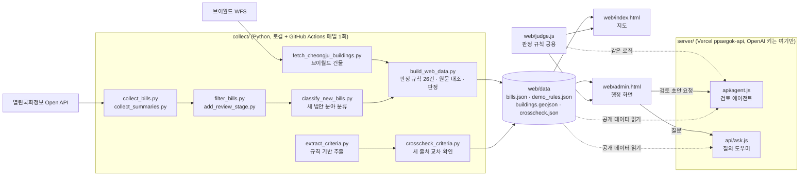

# 빼곡 (law-impact-map)

<div align="center">

### - 이 법 통과되면 우리 동네 몇 채? -
#### 국회 계류 법안의 적용 기준을 AI로 읽고, 영향받는 건물을 지도에 표시하는 입법 영향 지도
<br />


<br />

**[🗺️ 시제품 바로가기 (사창동 시범)](https://cbnu-lawmap.github.io/law-impact-map/)**

<br />
충북대학교 소프트웨어학부 「인공지능 프로그래밍」 2026-2 기말 팀 프로젝트 · C조
</div>

<br />

## ☁️ Introduction

국회 법안은 글로만 공개됩니다. "준공 30년 넘은 공동주택은 정밀안전진단을 받아야 한다" 같은 법안이 나와도, 어느 동네의 어떤 건물이 몇 채나 해당하는지는 알 수 없습니다.

이 프로젝트는 법안의 제안이유·주요내용에서 **적용 기준(용도·면적·층수·연도)** 을 AI로 추출하고, 건물 데이터와 대조해 **영향받는 건물을 건물 단위로 지도에 표시**합니다.

| 기능 | 설명 |
| :---: | --- |
| 법안 수집 | 열린국회정보 Open API로 건축·주거·안전 분야 계류 법안 수집 |
| 분야 분류 | 법안 텍스트를 분야(소방, 구조·노후, 주거 등)로 자동 분류 |
| 기준 추출 | 법안 요약문에서 `{용도, 면적, 층수, 연도}` 규칙 추출. 판정 시범 26건 중 24건은 Claude로 추출한 뒤 근거 문구가 원문에 그대로 있는지, 숫자가 근거에 있는지 자동 대조 (담당자 확인 전) |
| 교차 확인 | 같은 법안을 세 방식(우리 AI 추출, 규칙 기반 추출, 팀원 AI 추출)으로 뽑아 같은 숫자면 「교차 확인됨」, 다르면 「확인 필요」 |
| 건물 판정 | 규칙 × 건물 속성 → **대상 / 경계선 / 비대상 / 판정불가** |
| 지도 시각화 | 법안 선택 시 대상 건물 채색, 건물 클릭 시 속성과 판정 사유 |
| 행정 화면 | 담당 공무원용 상황판, 법안 검토 목록(심사 단계 포함), 진행 관리, 검토서 인쇄·한글(HWPX) |
| 질의 도우미 | 공개 법안 자료만 근거로 답하는 AI 질의 (`server/api/ask.js`) |
| 검토 에이전트 | AI가 도구를 골라 법안 조회 → 기준 추출 → 교차 확인 → 건물 판정 → 검토서 초안까지 진행 (`server/api/agent.js`, 사람 확인 필요) |

<br />

## 🧭 Project Scope

- 시범 지역: 청주시 서원구 **사창동** (2,448동) → 동 단위로 확장
- 법안 범위: 22대 국회 건축·주거·안전 관련 법안
- 판정 결과는 **건축물 데이터 기반 추정**이며 법률 판단이 아닙니다.

| 판정 | 의미 |
| :---: | --- |
| 대상 | 추출한 기준을 모두 충족 |
| 경계선 | 기준에 근소하게 못 미침 (예: 기준값 ±10%, 연도 ±1년). 입법 사각지대 후보 |
| 비대상 | 기준에 해당하지 않음 |
| 판정불가 | 판정에 필요한 속성이 비어 있음 (사창동 13.4%) |

<br />

## 📊 Data

| 데이터 | 출처 | 활용 |
| :--- | :--- | :--- |
| 법안 목록·제안이유·심사 경과 | 열린국회정보 Open API | 분야 분류, 기준 추출의 입력 |
| 건물통합정보 (`lt_c_bldginfo`) | 국토교통부 브이월드 WFS | PNU, 주용도, 연면적, 층수, 사용승인일, 구조, 건물 도형 |
| 행정동 경계 | `data/cheongju_emd.geojson` | 동 단위 수집 범위, 동별 집계 |

**사창동 건물 데이터 점검 결과** ([docs/data_check.md](docs/data_check.md))

| 항목 | 결과 |
| :--- | :--- |
| 수집 건물 | 2,448동 (동 경계 안, 중복 제거) |
| 판정 가능 (건축물대장 연계) | 2,120동, 86.6% |
| 판정 4개 기준 (용도·면적·층수·연도) | 모두 브이월드 한 곳에서 확보 |
| PNU·좌표 | 100% |
| 없는 항목 | 세대수, 세부용도, 용도지역 (필요 시 건축HUB·용도지역 레이어로 보완) |

<br />

## 💻 Architecture



```text
law-impact-map/
├─ collect/    # 수집·전처리·판정 데이터 생성 (Python)
├─ server/     # Vercel 서버리스: api/ask.js(질의 도우미), api/agent.js(검토 에이전트)
├─ web/        # GitHub Pages 정적 사이트: index.html(지도), admin.html(행정 화면), judge.js(판정)
├─ data/       # 원천·중간 데이터 (CSV, GeoJSON)
├─ notebooks/  # 분야 분류 모델 학습
├─ docs/       # 데이터 점검, 코드표, 추출 방식 문서
└─ .github/workflows/  # pages.yml(배포), daily-collect.yml(매일 새 법안 수집)
```

예전 계획의 `backend/`(RAG API)와 `frontend/`는 실제로 만들지 않아 지웠습니다. 서버 코드는 `server/`, 화면은 `web/`에 있습니다. 법안 검색은 벡터 검색(RAG)이 아니라 법안명·요약문 단어 일치로 고릅니다.

<br />

## 🛠️ Tech Stack

| 수집·전처리 | AI | 데이터 | 시각화 |
| :---: | :---: | :---: | :---: |
|  | <br /> | <br /> |  |

<br />

## 🚀 Getting Started

```bash
git clone https://github.com/cbnu-lawmap/law-impact-map.git
cd law-impact-map
cp .env.example .env   # 로컬 수집용 키 입력 (커밋 금지)
```

`.env`

```text
ASSEMBLY_API_KEY=   # 열린국회정보
VWORLD_KEY=         # 브이월드 (Referer 등록 도메인 필요)
```

건물 데이터 수집 (동 이름은 `data/cheongju_emd.geojson` 기준)

```bash
python collect/fetch_cheongju_buildings.py --emd 사창동
```

웹 시제품 데이터 생성과 로컬 실행 (`web/data/`를 다시 만든 뒤 http://localhost:8000 접속)

```bash
python collect/build_web_data.py
python -m http.server 8000 --directory web
```

행정 화면(`web/admin.html`, 사이트의 「행정 화면」 버튼)은 담당 공무원용 시제품입니다. 사각119·온지붕·필지 블랙박스의 행정 화면 구성을 법안 검토 업무에 맞게 옮겼습니다.
- 역할(법안 검토 담당 / 결재·관리 / 관내 총괄)별 첫 화면, 실무 ↔ 심사·검증 모드
- 상황판(지금 할 일 카드), 법안 검토 목록(필터·정렬·일괄 진행 변경·CSV), 법안별 집계와 건물 명부(확인 기록·적중률·CSV)
- 진행 현황(미검토/검토 중/보류/검토 완료, 인계 메모, CSV 내보내기·가져오기), 판정 규칙·검증
- 법안 영향 검토서 A4 인쇄와 한글(HWPX) 내려받기, 둘러보기, 하단 상태 바, 질의 도우미(AI)

로그인·서버 저장이 없는 시연용 공개 화면이며, 도입 시에는 행정망 내부에서만 씁니다. 진행 기록은 브라우저(localStorage)에만 남습니다.

AI 기능은 `server/`를 Vercel 프로젝트 `ppaegok-api`로 따로 배포해 씁니다(GitHub Pages에는 OpenAI 키를 둘 수 없음). 키는 Vercel 환경변수 `OPENAI_API_KEY`에만 있습니다. 행정 화면 설정에서 「질의 도우미 사용」을 끄면 두 기능 모두 서버에 연결하지 않습니다. 서버는 main에 병합하면 Vercel이 자동으로 배포합니다(프로젝트 `ppaegok-api`가 이 저장소에 연결돼 있고 Root Directory는 `server`). 급할 때 직접 배포하려면 저장소 루트에서 `npx vercel deploy --prod`를 실행합니다. `server/.vercelignore`가 `.env*` 파일을 올리지 않게 막습니다.

| 기능 | 파일 | 하는 일 |
| :--- | :--- | :--- |
| 질의 도우미 | `server/api/ask.js` | 질문과 관련된 법안을 단어 일치로 골라 그 내용만 근거로 답함. 답에 나온 숫자가 근거에 있는지 대조 |
| 검토 에이전트 | `server/api/agent.js` | OpenAI 함수 호출로 모델이 도구(법안 조회, 기준 추출, 교차 확인, 건물 판정, 검토서 초안)를 골라 최대 8단계 실행. 근거 문구가 원문에 없으면 버림. 판정은 원문 대조를 통과한 기준이나 시범 규칙으로만 함. 한 번 실행 토큰 12,000 상한, 같은 법안 10분 캐시, IP당 1분 5회 |

두 기능 모두 공개 법안 자료와 질문만 OpenAI로 보내며, 개인정보가 든 질문과 개별 건물 판정 질문은 서버에서 고정 문구로 거절합니다. 결과에는 항상 「사람 확인 필요」가 붙습니다.

새 법안은 GitHub Actions(`daily-collect.yml`)가 매일 1회 수집해 `bills.json`을 갱신합니다. 열린국회 키는 GitHub Secret `ASSEMBLY_API_KEY`로만 쓰며, 없으면 수집을 건너뜁니다.

### 시연 흐름

1. **법안 선택**: 지도 화면 왼쪽 목록에서 법안을 고릅니다 (예: 건축물관리법 2206436, 200㎡ 미만·2층 이하 해체 간소화).
2. **지도 색**: 사창동 건물이 대상(빨강)·경계선(노랑)·비대상·판정불가로 칠해지고, 건물을 누르면 판정 사유가 나옵니다.
3. **행정 화면**: 「행정 화면」에서 상황판과 법안 검토 목록(심사 단계 순)을 보고, 법안 상세에서 집계·건물 명부·교차 확인 결과를 확인합니다.
4. **에이전트 초안**: 「에이전트로 검토 초안 만들기」를 누르면 AI가 부른 도구와 이유가 단계별로 나오고 검토서 초안이 만들어집니다 (사람 확인 필요).
5. **한글 검토서**: 「인쇄용 검토서」에서 A4 인쇄 또는 「한글(HWPX) 내려받기」로 결재 문서 초안을 받습니다.

배포 사이트는 브이월드 WebGL 3D 지도를 씁니다. 브이월드 키는 저장소에 커밋하지 않고, 배포 도메인(`https://cbnu-lawmap.github.io`) 전용으로 발급한 키를 GitHub Secret `VWORLD_KEY`에 넣으면 배포할 때 `web/index.html`에 들어갑니다. 키가 없거나 브이월드 지도를 띄우지 못하면 기본 3D 지도(MapLibre, OSM 바탕)로 표시합니다. 로컬 실행은 키 없이 기본 3D 지도로 열립니다.

<br />

## 🔒 Policy & Ethics

| 항목 | 원칙 |
| :--- | :--- |
| 개인정보 | 건물명(`bld_nm`)에 개인 이름이 섞여 있어 저장하지 않음. 소유자 등 개인 식별 정보 미수집 |
| AI 신뢰성 | 추출 기준마다 법안 원문 근거 표시, 근거 문구가 원문에 없거나 숫자가 맞지 않으면 채택하지 않음. AI 결과는 「사람 확인 전」으로 표시하고 세 출처 교차 확인 상태를 함께 보여 줌 |
| 정치 중립 | 의원·정당 평가나 순위 표시 없음 |
| 보안 | API 키는 커밋하지 않음. OpenAI 키는 Vercel 환경변수, 브이월드·열린국회 키는 GitHub Secret에만 둠. OpenAI에는 공개 법안 텍스트와 질문만 전송 |
| 고지 | 판정 결과는 건축물 데이터 기반 추정이며 법률 자문이 아님 |

<br />

## 📅 Progress

| 단계 | 상태 |
| :--- | :---: |
| 주제·역할·협업 규칙 확정 | 완료 |
| 저장소·폴더 구조 | 완료 |
| 사창동 건물 수집·점검 | 완료 |
| 열린국회정보 법안 수집 (22대 계류 678건) | 완료 |
| 분야 분류 (9개 분야, Keras 신경망) | 완료 |
| 기준 추출 (AI 24건 + 사람 2건, 규칙 기반, 팀원 AI 76건) | 완료 (AI 결과는 사람 확인 전) |
| 기준 교차 확인 | 완료 |
| 건물 판정 (시범 26건) | 완료 |
| 지도 화면 · 행정 화면 | 공개 ([시제품](https://cbnu-lawmap.github.io/law-impact-map/)) |
| 질의 도우미 · 검토 에이전트 | 질의 도우미 운영 중, 에이전트는 배포 전 |
| 매일 새 법안 수집 | 워크플로 준비 (열린국회 키 등록 필요) |
| 보고서(한글)·발표자료(PPT) | 예정 |

<br />

## 👥 Member

| [최현규](https://github.com/choihyungyu0) | 도관우 | 지서윤 |
|:---:|:---:|:---:|
| Team Leader<br />Frontend · Architecture · 건물 데이터 | Backend<br />법안 수집 · 전처리 | Backend · Docs<br />AI 기준 추출 · GitHub 규칙 · 기획 |

<br />

## 💡 Commit Convention

- **feat**: 새로운 기능 추가
- **fix**: 버그 수정
- **docs**: 문서 수정
- **refactor**: 기능 변화 없는 코드 구조 개선
- **data**: 데이터 추가·갱신
- **chore**: 설정, 패키지 등 기타 작업

브랜치: `main` 보호, `feature/*`에서 작업 후 PR, 1명 이상 리뷰 후 병합

<br />

## 📎 Reference

- 데이터 점검: [docs/data_check.md](docs/data_check.md)
- 데이터 출처표: [data/README.md](data/README.md)
- [열린국회정보 Open API](https://open.assembly.go.kr/portal/openapi/main.do)
- [브이월드 오픈API](https://www.vworld.kr/dev/v4api.do)
